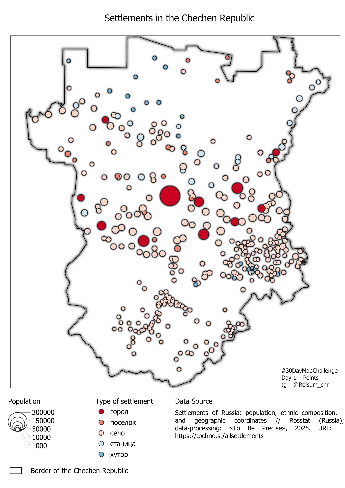
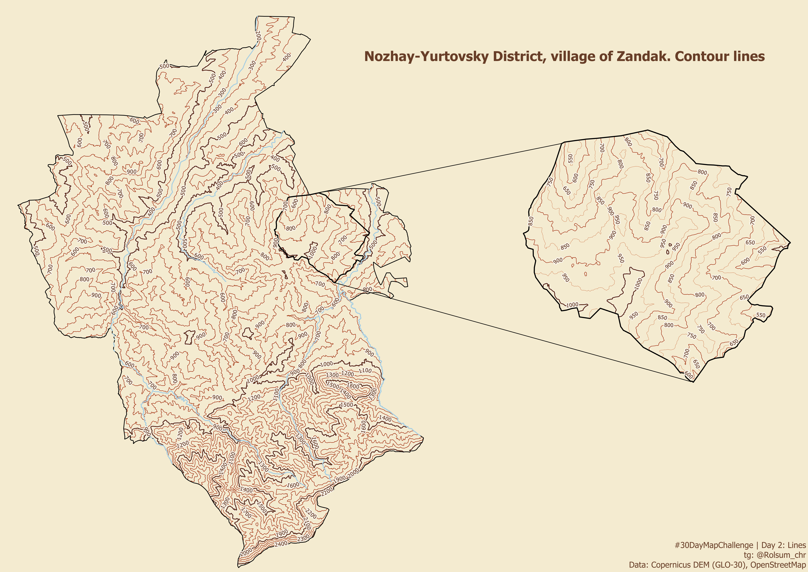
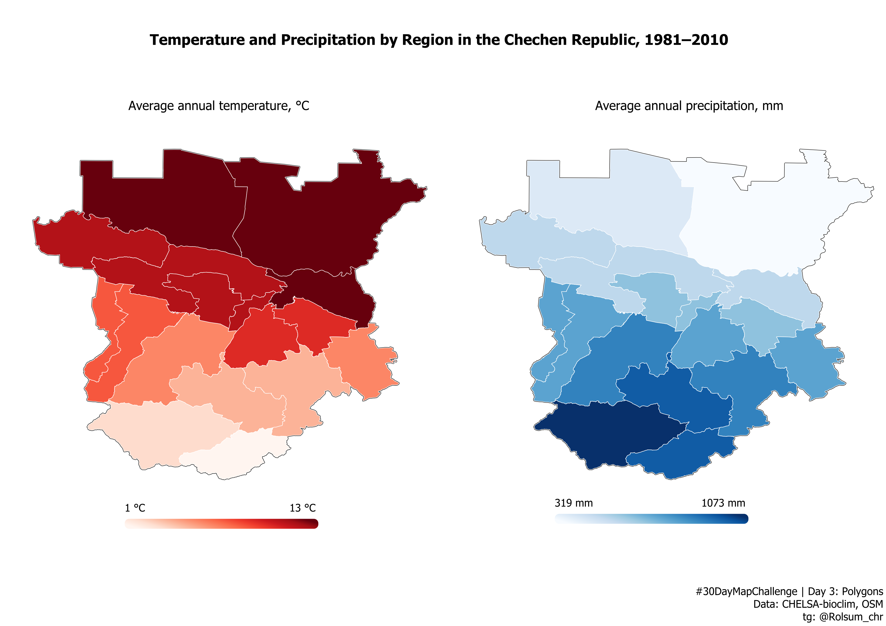
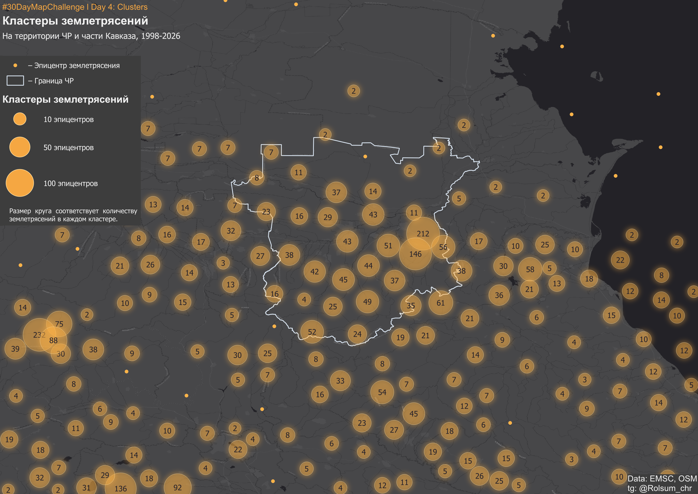
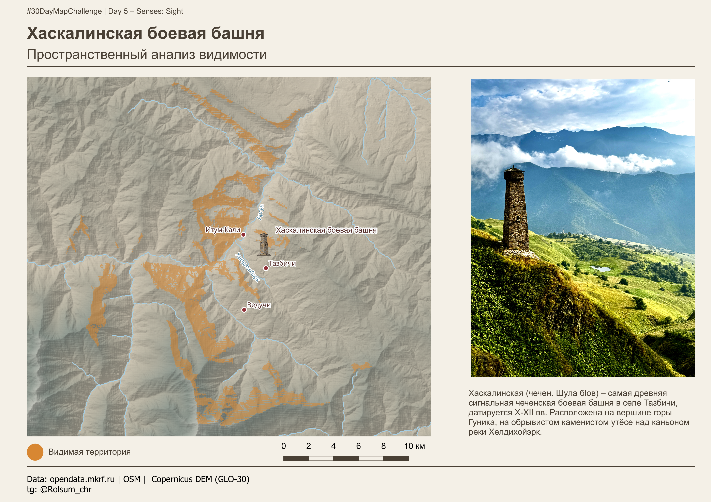
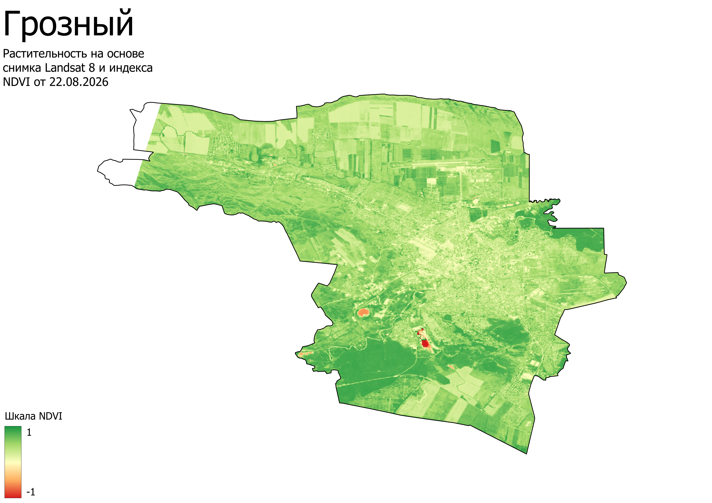

# 30DayMapChallenge

My entries for the annual mapping challenge – 30DayMapChallenge

### Day 1: Points

* **Tools:** QGIS 3.34
* **Data:** Rosstat (Russia); data-processing: «To Be Precise», 2025. URL: https://tochno.st/allsettlements
* **Description:** The map illustrates the republic's settlement pattern using proportional markers (the size of the circle depends on the population, and the color depends on the settlement's status).

### Day 2: Lines

* **Tools:** QGIS 3.34
* **Data:** Copernicus DEM (GLO-30), OpenStreetMap
* **Description:** The map uses contour lines to show the topography of the Nozhay-Yurtovsky District of the Chechen Republic and the village of Zandak (in the inset).

### Day 3: Polygons

* **Tools:** QGIS 3.34
* **Data:** CHELSA-bioclim, OpenStreetMap
* **Description:** This map shows the average annual distribution of temperatures and precipitation in the regions of the Chechen Republic for the period from 1981 to 2010.

### Day 4: Clusters

* **Tools:** QGIS 3.34, Python 3.12
* **Data:** Euro-Mediterranean Seismological Centre, OpenStreetMap
* **Description:** The spatial distribution of earthquake epicenters in Chechnya and part of the Caucasus over the period from 1998 to 2026.

### Day 5: Senses: Sight

* **Tools:** QGIS 3.34
* **Data:** opendata.mkrf.ru, Copernicus DEM (GLO-30), OpenStreetMap
* **Description:** A spatial analysis of the visibility of the Khaskalinskaya combat tower using the Visibility Analysis plugin in QGIS. The Khaskalinskaya Tower – the oldest Chechen watchtower in the village of Tazbichi – dates back to the 10th–12th centuries.

### Day 6: Vintage

**Didn't do/missed** 

### Day 7: 10 minute map

* **Tools:** QGIS 3.34
* **Data:** Landsat 8 Level-2 (Collection 2)
* **Description:** Calculation of the NDVI index for the city of Grozny, based on Landsat 8 Level-2 (Collection 2) data as of August 22, 2026. Completed in 9 minutes and 19 seconds.

